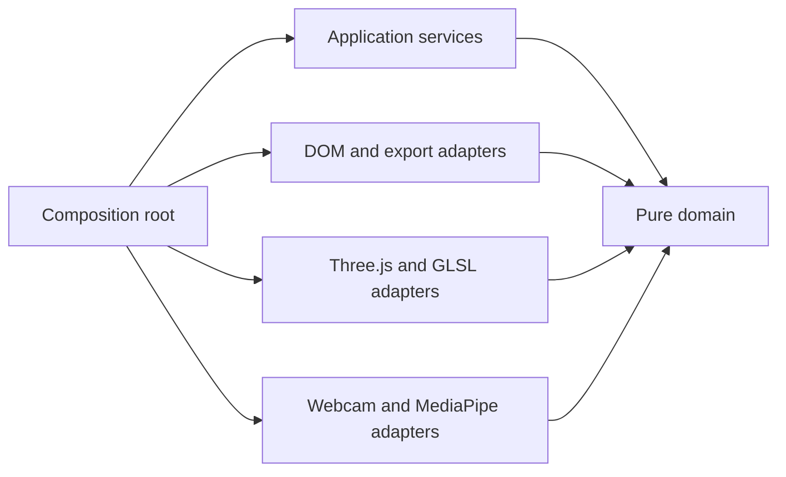

# Architecture

The project uses native JavaScript modules and dependency injection. Its inner layers run in Node tests without a DOM, GPU, webcam or downloaded model.



## Responsibilities

| Component                                                | Responsibility                                                                                              |
| -------------------------------------------------------- | ----------------------------------------------------------------------------------------------------------- |
| [main.js](src/main.js)                                   | Constructs concrete adapters, injects browser clock/frame scheduling, and starts the application            |
| [StudioController](src/application/studio-controller.js) | Coordinates camera/demo/stop, renderer lifecycle, status, quality adaptation and the frame loop             |
| [HandPipeline](src/application/hand-pipeline.js)         | Schedules hand inference, tracks identities, applies reference/classic policies and projects render targets |
| [FacePipeline](src/application/face-pipeline.js)         | Loads optional face resources, schedules inference, clears stale masks and isolates face failures           |
| [StudioView](src/ui/studio-view.js)                      | Reads controls into a settings object and renders status/view models; owns DOM events and fullscreen        |
| [LandmarkOverlay](src/ui/landmark-overlay.js)            | Draws optional projected hand diagnostics                                                                   |
| [Frame export](src/ui/frame-export.js)                   | Composites a local PNG using the same camera fit/mirror transform                                           |
| [Core](src/core)                                         | Pure geometry, gesture policies, hand identity, face geometry and synthetic demo inputs                     |
| [Vision](src/vision)                                     | MediaPipe/model lifetime, webcam acquisition and frame freshness                                            |
| [Render](src/render)                                     | GPU geometry, shaders, masks, palettes and disposal                                                         |
| [Static server](tools/serve.mjs)                         | Serves local files; owns no inference, application API or database                                          |

[vision/gesture.js](src/vision/gesture.js) is a compatibility re-export for existing calibration tools. New application code imports pure hand logic from [core/hand.js](src/core/hand.js).

## Ports and data flow

Application services receive concrete implementations through constructors:

- **Camera:** `start`, `stop`, `detect`, `dimensions`, `isActive`, `delegate`.
- **Face vision:** `start`, `stop`, `detect`, `isReady`, `delegate`.
- **Renderer:** `resize`, `render`, `triggerBurst`, `clearBurst`, `setQuality`, `dispose`.
- **View:** control callbacks, a settings snapshot, viewport dimensions and presentation methods.
- **Clock/scheduler:** milliseconds, request/cancel frame callbacks and page visibility.

These are structural JavaScript interfaces documented at their implementations, with no framework or base-class hierarchy. Application modules import only application/core modules; core modules import only core modules. [The architecture check](tools/check-architecture.mjs) enforces this direction.

```text
local camera → model adapter → hand geometry/identity → gesture policy
                                                       ↓
                                                 projected target → renderer

shared camera → optional face model → face geometry → skin/iris renderer
```

Demo inputs use the same gesture policies. Renderers receive targets and projected geometry, never raw interaction decisions. The view receives presentation state rather than reaching into a model or renderer.

## Computer-vision invariants

- Model coordinates are normalized and unmirrored. Hand distances correct for source aspect ratio.
- One shared contain/mirror transform projects camera, hand/face landmarks and PNG output into stage CSS pixels. Device pixels affect canvas backing resolution only.
- Domain time is seconds; MediaPipe timestamps and the browser frame callback use milliseconds. Animation deltas are capped at 50 ms; dropout decisions use elapsed time.
- Classification and secondary finger count require three distinct inference samples. Repeated video frames do not advance stabilization.
- Reference mode keeps a controlling hand ID; the second hand selects colour. Classic mode retains two-hand midpoint scaling. Gesture semantics and thresholds are unchanged by the architecture refactor.
- Blink/eyelid gating and face freshness prevent recolouring a closed or lost eye. Landmark masks cannot provide semantic skin or occlusion segmentation.

| Policy                     | Current setting                           |
| -------------------------- | ----------------------------------------- |
| Hand inference ceiling     | 30 Hz GPU / 20 Hz CPU                     |
| Stale hand inference       | 150 ms                                    |
| Face inference ceiling     | 24 Hz GPU / 15 Hz CPU; 12 Hz on Low       |
| Face scheduling fairness   | Wait at most 120 ms behind hand inference |
| Stale face geometry        | 160 ms                                    |
| Hand identity retention    | 550 ms                                    |
| Reference ownership window | 350 ms                                    |

These are scheduling limits, not measured performance guarantees. Geometry and rendering constants remain next to the code they control.

## Lifecycle and failure isolation

Camera and face operations use generation tokens. Stop, demo replacement and page disposal invalidate pending work. Late streams/models are closed; an optional face renderer is constructed only after its import is still current. Render resources loaded after disposal are released without starting a frame loop.

Face failures hide only face output. Hand inference failure stops the camera session with a retryable message. WebGL context loss releases the particle renderer and disables graphics controls until reload. Page hide releases resources; browser history restoration reloads the composition root.

## Assets and development server

[Asset synchronization](tools/sync-assets.mjs) hashes all local application modules and CSS, then generates matching import-map, entry-script and stylesheet revisions. Lazy modules receive the same revision. `predev`/`prestart` run synchronization; `npm run assets` refreshes revisions after edits. The Node server sends `Cache-Control: no-store`.

The frontend is JavaScript/HTML/CSS with GLSL shaders. The server is a separate Node.js static-file tool. There is no application backend or server-side computer vision. Third-party dependencies remain pinned: Three.js 0.170.0 and MediaPipe Tasks Vision 0.10.22-rc.20250304 with versioned hand/face model assets.

## Verification

Unit tests cover pure geometry and application policies with fake ports, including late startup cancellation, disposal, quality adaptation, stale frames and face scheduling. Browser tests cover both gesture modes, camera error handling, fullscreen/mirror alignment, exports and face effects. Run GPU browser scripts sequentially. See [QA.md](QA.md) for evidence and remaining physical-camera checks.
